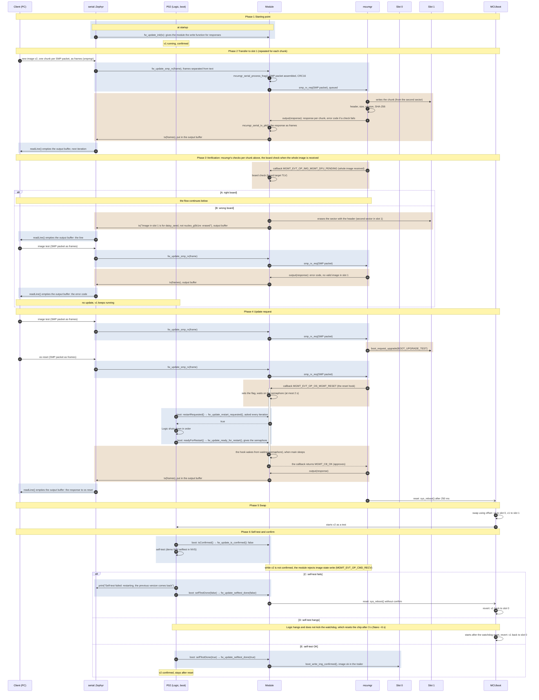

# P02 firmware update flow

How a new P02 image is received over the serial port, test-run through MCUboot, and then confirmed or
reverted. Applies to the swap variant (Nano, Nucleo) on Zephyr, with swap using offset. The document is
updated as we reach agreement.

Last updated 2026-11-16 · Version 59 (no names in the questions) · Svenska: [flow_sv.md](flow_sv.md)

Status:

* **Agreed**: decided
* **Proposed**: proposed, not decided
* **Open**: unanswered question

The documents in this folder:

* [Threads and the serial port](threads_en.md): why only main writes to the serial port
* [Work plan](work_plan_en.md): the steps, in which order, and what the reviewer tests
* [Possible additions](possible_additions_en.md): ideas that are not planned

## Background

The firmware update function is meant to be usable by more products than P02. A second product is being
built. P02's firmware update will be demonstrated to its developers, and their feedback decides what becomes
shared. That is why everything that is not specific to P02 is built as a Zephyr module: Kconfig options and a
small C API on top of mcumgr and MCUboot, which a product can use fully, partly or not at all.

| In the module (shared) | In P02 |
|---|---|
| The SMP transport on the same serial port as the app's text commands | `serial::Zephyr` separates SMP frames from text lines and passes the frames to the module, and writes the module's responses from the output buffer |
| The reset hook and the handshake "restart requested" / "app ready" | `boot::Zephyr` calls the module's C API, and `Logic` does its shutdown |
| The check of the board target TLV and the erase on the wrong board | – |
| Kconfig defaults (progressive erase, hash, size) | – |
| Rejecting `image state write` while the running image is not confirmed (during the self-test), and confirm or reset based on the self-test result the product reports | The self-test and reporting its result (`selfTestDone()`), and the demo field `selftest` in NVS |
| Reading and writing MCUboot's state: version, confirmed, second slot, confirm | `boot::Zephyr` is an adapter: each method calls a function in the module |

## The flow at a glance

The background shows which thread runs: blue the main thread, yellow mcumgr's thread. No colour: outside P02
(the client, MCUboot) or the restart itself. Received bytes are put in the ring buffer by the UART interrupt.

## The phases

### 1. Starting point (Agreed)

MCUboot is flashed, v1 is confirmed in slot 0, and P02 runs and takes commands on the serial port.

The module is always ready to receive an update. It registers the SMP transport with mcumgr
(`smp_transport_init()`) and its hooks (`mgmt_callback_register()`) itself at startup, with Zephyr's
`SYS_INIT`, before `main` runs. It needs nothing from P02 for that.

The only thing P02 gives the module is the write function for the responses: `serial::Zephyr` calls
`fw_update_init(tx)` in its constructor. The module needs it because the responses go out through
`serial::Zephyr` (only main writes to the serial port), and the module does not know P02 and cannot find
`serial::Zephyr` by itself. The responses come later and from mcumgr's thread, not as a return value from
`fw_update_smp_rx()`, so the module must have the write function from the start.

### 2. Transfer to slot 1 (Agreed; Open: verify on the Nano)

An external client (`smpmgr`) sends v2 in chunks, one per SMP packet, on the same serial port as the text
commands. The transfer is request–response: one chunk of a few hundred bytes per request, so the port is free
between requests. The module's transport assembles frames into SMP packets and passes them to mcumgr, which
writes slot 1 in its work queue at a lower priority than `Logic`. Blinking, commands and the watchdog carry on
as usual.

* Text commands and SMP packets are handled in the order they arrive. Text goes first, since `Logic` has the
  higher priority.
* The client decides the order between text commands and SMP packets, but never sends text in the middle of
  an SMP packet.
* One chunk at a time: the client sends the next chunk only when the response to the previous one has
  arrived. The image is never stored as a pile of chunks on the board, and mcumgr's buffers (default
  4 × 384 bytes, `CONFIG_MCUMGR_TRANSPORT_NETBUF_COUNT` and `_SIZE`, shared between requests and responses)
  cannot fill up during an upload.
* Time per chunk: an SMP packet is at most 384 bytes, as base64 about 5 frames of at most 127 bytes. On the
  Nucleo (UART 115200 baud) that takes about 45 ms on the serial port; on the Nano (USB) it is governed by the
  10 ms loop.
* Receiving does not block `Logic`: the interrupt puts bytes in the ring buffer, and `fw_update_smp_rx()` only
  copies and decodes, which takes microseconds. The flash writes happen in mcumgr's thread, at a lower
  priority.
* With swap using offset, mcumgr writes the image from the **second sector** of slot 1. The first sector is
  erased and left empty, as room for the swap (Zephyr's `flash_img.c` does this by itself).
* Slot 1 is erased progressively (`CONFIG_IMG_ERASE_PROGRESSIVELY`), one sector at a time.
* The responses are not written by mcumgr's thread: `tx()` puts them in an output buffer in `serial::Zephyr`,
  and main empties it in `readLine()`. Only main writes to the serial port, so a response cannot be mixed with
  text (see Threads).
* SMP frames are not echoed. `readLine()` decides the line's type from the first byte: `0x06` or `0x04` is
  SMP, everything else is text and is echoed as today.

> If `Logic` ever becomes heavy, mcumgr gets less time. The risk is then a timeout at the client, not an
> overflow, since the client waits for every response. See *Monitoring the transfer* in
> [Possible additions](possible_additions_en.md#monitoring-the-transfer-option).

> To verify on the Nano: the code runs from the same SPI flash as slot 1, so every erase or write stops all
> threads for a short while (an erase takes tens of ms). May also apply to the Nucleo, if slot 1 is in the
> same flash bank as the code. Measure blinking and the watchdog (3 s) during a whole upload.

> To verify on the Nano and the Daisy (USB): an SMP packet from `smpmgr` can be several frames of at most
> 127 bytes in one burst, and the ring buffer in `serial::Zephyr` is 256 bytes and read every 10 ms. Either
> the buffer is made larger, or frames are sorted already when they are received in the interrupt.

### 3. Verification (Agreed)

mcumgr checks the image while it is uploaded and rejects it with an error code to the client. The module adds
its own check when the image has been received.

* First chunk: the header's magic number (`0x96f3b83d`), that it is an MCUboot image at all
* First chunk: size, that the image fits in slot 1 and, with MCUboot's trailer, in slot 0
  (`CONFIG_MCUMGR_GRP_IMG_TOO_LARGE_SYSBUILD`)
* First chunk: a higher version than the running one, if the client sends `upgrade`
* Last chunk: SHA-256 over the whole image against the one the client sent (`CONFIG_IMG_ENABLE_IMAGE_CHECK`,
  the client sends `sha`)
* When the image has been received, the module's own check: **the right board**, a TLV of our own with the
  board target (added at signing through `CONFIG_MCUBOOT_EXTRA_IMGTOOL_ARGS`) against `CONFIG_BOARD_TARGET` in
  the running firmware. Done in the status hook (`DFU_PENDING`), since the TLVs are at the end of the image
* At startup: MCUboot checks the hash, and with *Signed images* also the signature. A broken image is erased
  and v1 starts. Checking the signature already on reception is an option, see [Possible additions](possible_additions_en.md)

If the board check fails, the module erases **the sector with the header** and writes a line on the serial
port, for example `Image in slot 1 is for daisy_seed, not nucleo_g0b1re: erased`. With swap using offset this
is the second sector of slot 1, not the first. A following `image test` is then rejected by mcumgr, and
`image state-read` shows slot 1 as empty.

> The header in slot 1 is read in several places (the module's board check, `Second slot` in P02's
> `status`). All of them must account for where the image starts, preferably through the same function mcumgr
> uses rather than an offset of their own.

> Why erase and not just decline `os reset`: the test mark stays, so the next restart (power, RESET,
> watchdog) would start the image anyway. Rejecting `image test` itself is not possible either. mcumgr's image
> hooks do not run before `image test`, and the general hook `MGMT_EVT_OP_CMD_RECV`, which can reject any
> command, only sees the command's group, id and operation, not the CBOR content. `image test` and
> `image confirm` are the same command, told apart only by the field `confirm` in the content, so the hook
> would also reject confirming the running image.

### 4. Update request (Agreed; Open: orderly shutdown)

The client requests the test over SMP: `smpmgr image test <hash>` marks the image in slot 1 for test (mcumgr
calls `boot_request_upgrade()`), and `smpmgr os reset` requests a restart.

The module registers a reset hook (`CONFIG_MCUMGR_GRP_OS_RESET_HOOK`), which runs in mcumgr's thread. The
handshake:

* `boot` shows that a restart has been requested. `Logic` asks every iteration (for example
  `restartRequested()`).
* `Logic` does its shutdown, decides by itself when it is done, and signals that to `boot` (for example
  `readyForRestart()`).
* The hook has been waiting for the signal and now approves. mcumgr responds to the client and restarts after
  `CONFIG_MCUMGR_GRP_OS_RESET_MS` (250 ms).

`Logic` only knows `boot::Interface`, and only `boot` (through the module) knows mcumgr.

The client may test-run any valid image in slot 1, even an older version. After an update the previous
version is there, so `image test` on it is an intentional rollback, with the same safety net (self-test,
confirm by P02, revert).

> The hook applies to every `os reset`, not only after `image test`. If `Logic` has not signalled within the
> time limit (Kconfig, default 2 s), the hook declines the restart with `busy`, and the client can try again.
> The shutdown saves nothing: `Logic` writes `Restarting for firmware update`, turns off the LED, stops
> blinking and signals "ready". The loop then keeps running until the restart, so that main can write the
> response to `os reset` from the output buffer. If the client wants to keep the settings, it runs `store`
> before `os reset`.

### 5. Swap (Agreed; Open: verify v1's location)

MCUboot (swap using offset) swaps the images sector by sector and starts v2 as a test. Since v2 already sits
one sector into slot 1, the image in slot 0 does not first have to be moved one sector, as in swap using
move. An update therefore writes the flash about a third less. v1 remains in slot 1.

> To verify: where v1 ends up in slot 1 after the swap (at sector 0 or one sector in), and that mcumgr
> (`image state-read`), `status` and an `image test` on v1 (rollback) find it.

### 6. Self-test and confirm (Agreed)

v2 sees that it is not confirmed (`boot_is_img_confirmed()` is false) and runs a self-test: all drivers are
created and the ADC reports `isInitialized()`, NVS can be reached (missing or corrupt settings give defaults
and count as passed), and `Logic`'s loop has run for a certain time (for example 10 s) without the watchdog
firing.

* **Passed:** P02 reports the result (`boot::Interface::selfTestDone(true)` → `fw_update_selftest_done(true)`),
  and the module confirms with `boot_write_img_confirmed()`. v2 stays after the next reset.
* **Failed:** P02 writes a line (`Self-test failed: restarting, the previous version comes back`) and reports
  the result (`selfTestDone(false)`). The module restarts with `sys_reboot()` without confirm, and MCUboot
  reverts to v1. P02 writes the line itself before the report, since the module's `tx()` only puts it in the
  output buffer, which main does not have time to empty before the restart.
* **Hangs:** `Logic` does not kick the watchdog, which resets the chip after 3 s (Nano ~6 s). MCUboot reverts
  to v1.

While the running image is not confirmed, the module rejects every `image state write` with the hook
`MGMT_EVT_OP_CMD_RECV`. Otherwise the client could send `image confirm` during the self-test and skip it. The
hook cannot tell `image test` from `image confirm`, but during the self-test there is no reason to allow
either. The module reads `boot_is_img_confirmed()` itself and needs no new call from P02. The module confirms
or resets based on the result P02 reports, but cannot check that a self-test actually ran.

> After a revert, MCUboot sets *image ok* on v1, so v1 starts as confirmed and runs no self-test. MCUboot does
> not try again by itself, since slot 1 is no longer marked for test. So there cannot be a loop between v1
> and v2: a new attempt needs a new `image test` from the client. v1 sees that something happened because
> `status` shows `Second slot: v2` without the test mark.

If the client does not want to keep v2 after confirm, it does a rollback: `image test` on the previous
version, which remains in slot 1.

> For the demo: the field `selftest` in NVS decides whether the self-test passes or fails. The text command
> `selftest fail` or `selftest pass` sets it, and `store` saves it. NVS is outside the slots, so v2 reads what
> v1 saved. Demo: in v1 `selftest fail` and `store`, then upload, `image test` and `os reset`: v2's self-test
> fails and it reverts to v1. Then `selftest pass`, `store` and the same again: v2 is confirmed. The field
> stays until someone changes it, so `status` shows it. No Kconfig option: P02 is a demo, and the self-test is
> in P02, not in the module.

> To verify: that an image flashed with `west flash` is confirmed, so that the hook does not reject
> `image state write` on a freshly flashed board.

## Threads (Agreed)

P02 has one thread, `Logic`'s loop in main. mcumgr brings its own. The module has no thread of its own: its
code runs in the thread that calls it. Only main writes to the serial port. Explanation with pictures:
[Threads and the serial port](threads_en.md).

| Thread | Priority | What runs there |
|---|---|---|
| main (`Logic`) | 0 | The loop every 10 ms. Asks every iteration whether a restart for an update has been requested (`restartRequested()`). mcumgr only runs when main sleeps, so a loop that never sleeps starves the upload. `readLine()` receives, separates SMP frames from text and calls `fw_update_smp_rx()`, echoes text and empties the output buffer. Also `print()`, the drivers' `printk()`, the shutdown and the self-test |
| mcumgr's work queue | 3 | Handles the SMP packets, writes the chunks to flash, calls `output()` and thus `tx()`, and the callbacks (the reset hook, `DFU_PENDING` with the board check) |
| UART interrupt (no thread) | – | Puts received bytes in the ring buffer (Nucleo). The Nano polls from main |

| From → to | What | How | Status |
|---|---|---|---|
| main → mcumgr | SMP packets | `smp_rx_req()` puts the packet in mcumgr's queue (Zephyr) | Agreed |
| mcumgr → serial port | The responses, and the board check's line | `tx()` puts frames in an output buffer in `serial::Zephyr`, and main empties it in `readLine()`. If the buffer is full, `tx()` waits for main, never the other way round | Agreed |
| mcumgr → main | "Restart requested" | A flag (`atomic_t`) that the reset hook sets and `restartRequested()` reads | Proposed |
| main → mcumgr | "Ready" | A semaphore (`k_sem`) that `readyForRestart()` gives and the hook waits on, with the time limit | Proposed |
| both → flash | Slot 1 (mcumgr), NVS on `store` (main) | Different partitions on the same flash. Zephyr's flash driver should have its own lock | Open: verify per board |

## State of the images

| After phase | Slot 0 | Slot 1 | Status in slot 0 |
|---|---|---|---|
| 1 Starting point | v1 | empty or old | confirmed |
| 2–3 Transfer, verification | v1 | v2 (from the second sector) | confirmed |
| 4 Request | v1 | v2 (marked for test) | confirmed |
| 5 Swap | v2 | v1 | **test** |
| 6 Self-test passed, P02 confirms | v2 | v1 | confirmed |
| 6 Self-test fails, revert | v1 | v2 | confirmed |

## To review

### The word *test* for the state between swap and confirm (Open: judge at review)

For now we keep MCUboot's and mcumgr's word *test* (`BOOT_UPGRADE_TEST`, `smpmgr image test`, "test swap" vs.
"permanent"), so that documents, commands and API use the same word. The problem: *test* sounds like a check
you do and then move on from, but it is a trial run with the intention of keeping the image.

* Alternative: *trial*, the word in ARM's PSA Certified Firmware Update API (the state `TRIAL`,
  `psa_fwu_accept()` / `psa_fwu_reject()`), and in *trial boot*. Says the intention, but gives two words for
  the same thing: our documents *trial*, commands and API *test*.
* A change affects the glossary row *Swap variant* ("starts it as a test") and the update demo in
  `docs/platform_zephyr.md`.
* Include the second product's developers in the judgement after the demo.

## Open questions

### Swap using offset on the Nano (Open)

Zephyr's default for Espressif chips is overwrite only, and it is not known whether MCUboot's Espressif port
supports swap using offset. Swap using offset also needs an extra sector in slot 1, so the Nano's partitions
may have to change in its board definition.

* Build with `MCUBOOT_MODE_SWAP_USING_OFFSET` for `arduino_nano_esp32/esp32s3/procpu` and run the update demo
  (test, then revert).
* If it does not work: swap using move on the Nano and offset on the Nucleo, or move on both. Decided when the
  result is in.

### The version on ESP-IDF (Open)

On ESP-IDF, `status` shows the stub's v1.0.0, since the repository sets no version there. Not part of
firmware update. Proposal for later: `PROJECT_VER` from the same `VERSION` file as Zephyr.

## Decisions so far

| Decision | Choice | Status |
|---|---|---|
| Scope | Commands in `Logic` and a real `boot::Zephyr` (confirm and versions), not only the stub | Agreed |
| The overall flow | Phases 1–6 above | Agreed |
| Swap technique | Swap using offset (`MCUBOOT_MODE_SWAP_USING_OFFSET`): mcumgr writes the new image one sector into slot 1, and MCUboot swaps without first moving the image in slot 0. About a third fewer flash writes per update, a faster swap, and Zephyr's default on the Nucleo. Replaces swap using move, which the update demo (#91) and `zephyr/app/Kconfig.sysbuild` use today. The change in the code, AGENTS.md (the row *Bootloader* and the glossary row *Swap variant*) and a new run of the update demo on both boards are done as a step of their own. To verify: support on the Nano (see Open questions), and where v1 ends up in slot 1 after the swap. Rejected: swap using move (first moves slot 0 one sector, more writes), swap using scratch (the scratch area is written for every sector and wears the most), overwrite only (no revert) | Agreed; Open: verify on the Nano |
| Zephyr module | The shared part is built as a Zephyr module in this repository (for example `modules/fw_update/`, with its own `zephyr/module.yml`, Kconfig, C API and documentation), which does not know P02. Moved to its own repository in `west.yml` when the second product uses it. Rejected: its own repository now (two PRs per change while the API changes), building it in P02 and splitting it out later (P02 details leak in) | Agreed |
| Where the SMP transport lives | In the module, with a C API. `serial::Zephyr` passes frames starting with `0x06 0x09` or `0x04 0x14` to the module, and everything else to `Logic`. Follows from the module decision. To verify: Zephyr's helper functions for frames (`serial_util.c`) are only compiled with `MCUMGR_TRANSPORT_SERIAL_HAS_SMP_OVER_CONSOLE`. Rejected: the transport in P02 (each product writes it itself), the module owns the UART (clashes with the interrupt-driven `serial::Zephyr` and the DTR handling) | Agreed |
| Writing to the serial port | Only main writes. The module gets a write function from `serial::Zephyr` at startup (`fw_update_init(tx)`), and `tx()` puts the responses in an output buffer that main empties in `readLine()`. `Logic` does not change. Cost: at most 10 ms per response (about 4 s for 200 KB). To verify: the output buffer's size, and that `smpmgr` skips text between frames. Rejected: mcumgr's thread writes itself, with a lock in `serial::Zephyr` (the drivers' `printk()` bypasses the lock and can end up in the middle of a frame) | Agreed |
| Shutdown before restart | `Logic` decides when the shutdown is done and signals it to `boot`. `boot` (through the module's reset hook) then approves the restart with mcumgr | Agreed |
| Time limit for the shutdown | If the app has not signalled "ready" within the time limit, the hook declines the restart with `busy`, and the client can try again. The time limit is a Kconfig option in the module (for example `CONFIG_FW_UPDATE_RESET_READY_TIMEOUT_MS`, default 2 s, shorter than `smpmgr`'s timeout). If the app hangs, the watchdog restarts the board. Rejected: approve anyway (overrides the app's decision), no time limit (SMP hangs with the app, and the client gets a timeout instead of a response) | Agreed |
| What the shutdown does | `Logic` writes a line (`Restarting for firmware update`), turns off the LED, stops blinking and signals "ready", and the loop keeps running until the restart so that the response to `os reset` gets out. Nothing is saved, as with every reset: only `store` saves. The client runs `store` before `os reset` if the settings are to be kept. Rejected: automatic `store` (breaks the rule, a flash write can clash with the time limit, especially on the Nano), save only changed settings (a "changed" flag, and the rule is broken anyway) | Agreed |
| Boards in the first version | The swap variant: Nucleo and Nano, where test, confirm and revert have already been shown by hand (#91, with swap using move; redone with swap using offset). The module is not enabled for the Daisy (RAM load) or ESP-IDF (no MCUboot). Rejected: the Daisy as well (the question of test/confirm/revert in RAM load is open, and the USB fault after a software reset can make a successful update look failed), all Zephyr boards with a RAM-load flow of their own (the most work before the demo) | Agreed |
| Boards without firmware update | `boot::Interface` gets a method (for example `isUpdateSupported()`). Where it is false (Daisy, ESP-IDF), `confirm` answers `firmware update not supported on this board`, and `status` writes `Firmware update: not supported` instead of confirmed and the second slot. Rejected: the stub answers as today (`already confirmed` is misleading), remove `confirm` on those boards (`unknown command` does not explain why) | Agreed |
| Asking for the version | No new command. People use `status` in `tio`: the running image (`Firmware: v1.0.0+0 (confirmed)`) and slot 1 (`Second slot: v2.0.0+0`, `(test at next reset)` when it is marked for test, or `empty` without a valid header, for example after the erase on the wrong board). The mark comes from a new method in `boot::Interface` (for example `isSecondaryPending()`), the same flag as `pending` in `state-read`. Clients and scripts use `smpmgr image state-read` (version, hash, active, confirmed, pending per slot). Both read the MCUboot header, whose version comes from `zephyr/app/VERSION`, so they cannot show different things. On boards without firmware update, `status` shows the version from the same file. Rejected: `status` without the test mark (a manual reset after `image test` swaps without the `tio` user seeing it), a separate command `version` (a third way to the same information; scripts have `state-read`), the same version on ESP-IDF now (not part of firmware update) | Agreed |
| Transport | SMP (mcumgr) on the same serial port as the text commands. P02 separates SMP frames from text, mcumgr writes slot 1 in a thread of its own, the client is `smpmgr`. Rejected: our own protocol in `Logic` (rewrites mcumgr), a separate port (the Nano's USB-Serial/JTAG has only one) | Agreed |
| mcumgr in the build | A Zephyr subsystem, enabled and configured with Kconfig in `prj.conf` (`MCUMGR`, `MCUMGR_GRP_IMG`, `IMG_MANAGER`, `MCUMGR_GRP_OS`). The modules `mcuboot` and `zcbor` are already in `west.yml`. The transport is our own code (`smp_transport_init()`), since `smp_uart` takes the whole UART | Agreed |
| Priority | Thread priority, set at build time: mcumgr's work queue (`CONFIG_MCUMGR_TRANSPORT_WORKQUEUE_THREAD_PRIO`, default 3) below `Logic` (main, 0). Can be moved when there are more threads, but not while P02 runs. Rejected: priority chosen at run time (the work queue is not visible from outside), a rule for when an update may be received | Agreed |
| Order between text commands and SMP packets | The client's responsibility. P02 handles what arrives in the order it arrives | Agreed |
| Checks of the image | mcumgr's built-in ones (header, size with `TOO_LARGE_SYSBUILD`, `upgrade`, SHA-256 with `IMG_ENABLE_IMAGE_CHECK`) plus one of our own: the right board, the board target in a TLV of its own, checked when the image has been received. Rejected: the chip's type ID (chip-specific code per platform, misses boards with the same chip), board revision (our boards have no ID), our own check of the whole slot 1 with the result in `image state-read` | Agreed |
| Image for the wrong board | The module erases the sector with the header in slot 1 at once (with swap using offset, the second sector) and writes a line on the serial port. Rejected: decline `os reset` and keep the image (the test mark stays, the next restart starts it), the reason in `image state-read` (more code, the line already shows in `tio`), reject `image test` with the hook `MGMT_EVT_OP_CMD_RECV` (does not see the content, so it also rejects `image confirm`) | Agreed |
| `boot::Zephyr` and the module | `boot::Zephyr` is a thin adapter: each method in `boot::Interface` calls a function in the module, and all reading and writing of MCUboot's state in P02 goes through the module. Rejected: `boot::Zephyr` directly against MCUboot's API (two ways to the same state), one and the same code (the module is C and does not know P02; `boot::Interface` is P02's C++ interface, with a stub for the host tests) | Agreed |
| Who confirms after the swap | The module, based on the self-test result P02 reports (`selfTestDone()`): passed gives confirm, failed gives a reset without confirm (revert). If the self-test hangs, the watchdog resets the chip. A client that does not want to keep v2 does a rollback with `image test` on the previous version in slot 1. Rejected: two steps, where the client confirms after P02's self-test (if the client never comes back, there is an unexpected revert at the next restart, for example a power cut), only the client without a self-test (a broken v2 runs until someone notices) | Agreed |
| Confirm during the self-test | The module rejects `image state write` with the hook `MGMT_EVT_OP_CMD_RECV` while the running image is not confirmed, and reads that itself with `boot_is_img_confirmed()`. To verify: that `west flash` gives a confirmed image. Rejected: allow it (the client can skip the self-test with `image confirm`) | Agreed |
| Older version in slot 1 | May be test-run; it is the client's choice (`upgrade` on upload, `image test` on the previous version as a rollback). With swap using offset: verify that the previous version is found in slot 1 after the swap (see phase 5). Rejected: P02 always rejects lower versions (the previous version in slot 1 can still be test-run), erase slot 1 on confirm (no way back) | Agreed |
| What the self-test checks | "Came up and runs", with what already exists: the drivers created and the ADC `isInitialized()`, NVS can be reached (missing or corrupt settings give defaults and count as passed), and `Logic`'s loop has run for a certain time (for example 10 s) without the watchdog. No changes to the interfaces. Rejected: corrupt NVS as a failure (a data problem that v1 also has would stop all updates, even a v2 that fixes it), `selfTest()` in every driver (changes all drivers and stubs), only that the loop started (catches nothing the watchdog does not already catch). For the demo, the field `selftest` in NVS can force a failure, without a Kconfig option since P02 is a demo. Rejected for the demo: a build flag (one build per outcome) | Agreed |
| The text command `confirm` | Exists in `Logic` besides `smpmgr image confirm` and calls `boot::Interface::confirm()`. Answers `already confirmed` if the image is already confirmed. Now that the module confirms after the self-test it is hardly needed, and if kept, the module needs a function of its own for it: to decide whether it is kept for manual tests in `tio` or removed. The warning at startup is no longer needed, since no image is left unconfirmed after the self-test | Open |
| Who requests the test and the restart | The client over SMP (`image test`, `os reset`). `Logic` gets to shut down in order through mcumgr's reset hook, which can also decline. Rejected: a text command `update` in `Logic`, and both ways equal (two ways to test) | Agreed |

## Terms

From the glossary in `AGENTS.md`, and what is to be added there. The context is in parentheses, since the
words have other meanings in other contexts.

| Term | Meaning | Status |
|---|---|---|
| *Firmware update* | Installing a new P02 version through MCUboot's two slots. Used instead of "upgrade", since an older version in slot 1 is also an update | Glossary |
| *Swap using offset (firmware update)* | MCUboot's swap technique in the swap variant: the new image sits one sector into slot 1, and MCUboot swaps the images sector by sector without first moving the image in slot 0. Replaces *swap using move* in the glossary row *Swap variant* | Agreed |
| *TLV (MCUboot image)* | Type-Length-Value: entries at the end of an MCUboot image, after the code, each with a type, a length and a value. imgtool adds among others the SHA-256 and, with *Signed images*, the signature. The module adds a TLV of its own with the board target, which the board check reads | Explanation |
| *SMP* | Simple Management Protocol: the protocol for managing a device, for example uploading an image (the group *image*) or restarting it (the group *os*). On the device it is received by mcumgr, a Zephyr subsystem. Every request and response is an *SMP packet* (header and CBOR, with a CRC16 on the serial port). On the serial port, every SMP packet is split into one or more *frames*, so P02 can tell them from text commands | Explanation |
| *Chunk (firmware update)* | A part of the image, a few hundred bytes, that the client sends in one upload request. A chunk goes in one SMP packet, and mcumgr responds to each chunk before the client sends the next | Explanation |
| *Frame (SMP on a serial port)* | A line on the serial port, at most 127 bytes, starting with `0x06 0x09` (the first frame of an SMP packet) or `0x04 0x14` (continuation) | Explanation |
| *CBOR* | Concise Binary Object Representation (RFC 8949): a binary format for structured data, like JSON but in bytes instead of text. The content of an SMP packet, after the 8-byte header, is a CBOR map with the command's arguments, for example `{"hash": …, "confirm": false}` for `image test`. mcumgr encodes and decodes it with the module `zcbor` | Explanation |
| *smpmgr* | A Python command-line program on the PC that sends SMP commands to the device: the client in the flow. The commands here: `image upload`, `image state-read`, `image test`, `image confirm` and `os reset`. It is already used for the recovery upload to the Daisy | Explanation |
| *Verify (firmware update)* | The checks of a received image in slot 1 before it may be tested: mcumgr's built-in ones (header, size, hash) and the module's board target check. Not MCUboot's check at startup | Agreed |
| *Request a test (firmware update)* | The client marks the image in slot 1 for test (`image test`) and requests a restart (`os reset`). At the next reset MCUboot swaps it in and starts it as a test. The word *test* is to be judged again at the review, see To review | Agreed |
| *Self-test (firmware update)* | P02's own check after a swap: that it came up and runs (drivers, NVS, the loop runs without the watchdog). P02 reports the result, and the module confirms (passed) or resets (failed). For the demo, the field `selftest` in NVS can force a failure | Agreed |
| *Confirm (firmware update)* | Only against MCUboot: the running image is kept after the next reset. Done by the module when P02 reports a passed self-test. During the self-test the module rejects `image confirm` from the client | Agreed |
| *Revert (firmware update)* | MCUboot puts the previous image back at a reset, since the new one was not confirmed. The module restarts without confirm if the self-test fails, and the watchdog if it hangs | Agreed |
