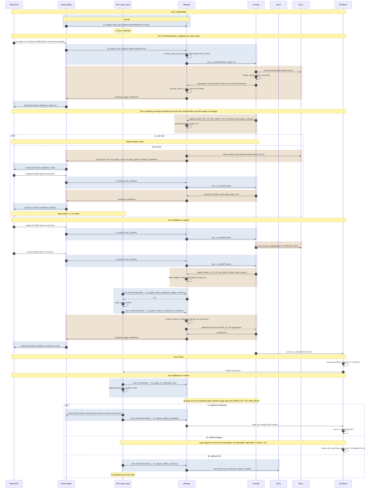

# P02 firmware update-flöde

Hur en ny P02-image tas emot över serieporten, testkörs genom MCUboot och sedan får confirm eller revert.
Gäller swap-varianten (Nano, Nucleo) på Zephyr, med swap using offset. Dokumentet uppdateras efter hand som
vi kommer överens.

Senast uppdaterad 2026-11-16 · Version 59 (inga namn i frågorna) · English: [flow_en.md](flow_en.md)

Status:

* **Överens**: beslutat
* **Förslag**: föreslaget, inte beslutat
* **Öppen**: obesvarad fråga

Dokumenten i den här mappen:

* [Trådar och serieporten](threads_sv.md): varför bara main skriver till serieporten
* [Arbetsplan](work_plan_sv.md): stegen, i vilken ordning, och vad granskaren testar
* [Möjliga tillägg](possible_additions_sv.md): idéer som inte är planerade

## Bakgrund

Funktionen för firmware update ska kunna användas av fler produkter än P02. En andra produkt är under
uppbyggnad. P02:s firmware update demas för dess utvecklare, och deras feedback avgör vad som blir gemensamt.
Därför byggs det som inte är P02-specifikt som en Zephyr-modul: Kconfig-val och ett litet C-API ovanpå mcumgr
och MCUboot, som en produkt kan använda helt, delvis eller inte alls.

| I modulen (gemensamt) | I P02 |
|---|---|
| SMP-transporten på samma serieport som appens textkommandon | `serial::Zephyr` skiljer SMP-frames från textrader och lämnar frames till modulen, och skriver ut modulens svar från utbufferten |
| Reset-hooken och handskakningen "omstart begärd" / "appen redo" | `boot::Zephyr` anropar modulens C-API, och `Logic` gör sitt avslut |
| Kontrollen av board target-TLV:n och raderingen vid fel kort | – |
| Kconfig-standardvärden (progressiv radering, hash, storlek) | – |
| Att `image state write` nekas så länge den körande imagen inte är confirmed (under självtestet), och confirm eller reset utifrån det självtestresultat produkten rapporterar | Självtestet och rapporten av resultatet (`selfTestDone()`), och demofältet `selftest` i NVS |
| Läsning och skrivning av MCUboots tillstånd: version, confirmed, andra sloten, confirm | `boot::Zephyr` är en adapter: varje metod anropar en funktion i modulen |

## Flödet i stort

Bakgrunden visar vilken tråd som kör: blå main-tråden, gul mcumgrs tråd. Utan färg: utanför P02 (klienten,
MCUboot) eller själva omstarten. Mottagna byte läggs i ringbufferten av UART-avbrottet.

## Faserna

### 1. Utgångsläge (Överens)

MCUboot är flashad, v1 ligger confirmed i slot 0, och P02 kör och tar emot kommandon på serieporten.

Modulen är alltid redo att ta emot en update. Den registrerar själv SMP-transporten hos mcumgr
(`smp_transport_init()`) och sina hookar (`mgmt_callback_register()`) vid start, med Zephyrs `SYS_INIT`, innan
`main` körs. Det behöver inget från P02.

Det enda P02 ger modulen är skrivfunktionen för svaren: `serial::Zephyr` anropar `fw_update_init(tx)` i sin
konstruktor. Modulen behöver den eftersom svaren går ut genom `serial::Zephyr` (bara main skriver till
serieporten), och modulen känner inte till P02 och kan inte hitta `serial::Zephyr` själv. Svaren kommer senare
och från mcumgrs tråd, inte som returvärde från `fw_update_smp_rx()`, så modulen måste ha skrivfunktionen från
start.

### 2. Överföring till slot 1 (Överens; Öppen: verifiera på Nano)

En extern klient (`smpmgr`) skickar v2 i chunks, en per SMP-paket, på samma serieport som textkommandona.
Överföringen är fråga–svar: en chunk om några hundra byte per anrop, så porten är ledig mellan anropen.
Modulens transport sätter ihop frames till SMP-paket och lämnar dem till mcumgr, som skriver slot 1 i sin
arbetskö med lägre prioritet än `Logic`. Blink, kommandon och watchdog fortsätter som vanligt.

* Textkommandon och SMP-paket behandlas i den ordning de kommer. Text går före, eftersom `Logic` har högre
  prioritet.
* Klienten bestämmer ordningen mellan textkommandon och SMP-paket, men skickar aldrig text mitt i ett
  SMP-paket.
* En chunk åt gången: klienten skickar nästa chunk först när svaret på den förra har kommit. Imagen lagras
  aldrig som en hög chunks i kortet, och mcumgrs buffertar (standard 4 × 384 byte,
  `CONFIG_MCUMGR_TRANSPORT_NETBUF_COUNT` och `_SIZE`, delade mellan förfrågningar och svar) kan inte fyllas
  under en uppladdning.
* Tid per chunk: ett SMP-paket är högst 384 byte, som base64 ungefär 5 frames på högst 127 byte. På Nucleo
  (UART 115200 baud) tar det ungefär 45 ms på serieporten, på Nano (USB) styrs det av loopen på 10 ms.
* Mottagningen blockerar inte `Logic`: avbrottet lägger byte i ringbufferten, och `fw_update_smp_rx()`
  kopierar och avkodar bara, vilket tar mikrosekunder. Flashskrivningen görs i mcumgrs tråd, med lägre
  prioritet.
* Med swap using offset skriver mcumgr imagen från **andra sektorn** i slot 1. Den första sektorn raderas och
  lämnas tom, som plats för swappen (Zephyrs `flash_img.c` gör det själv).
* Slot 1 raderas progressivt (`CONFIG_IMG_ERASE_PROGRESSIVELY`), en sektor i taget.
* Svaren skrivs inte av mcumgrs tråd: `tx()` lägger dem i en utbuffert i `serial::Zephyr`, och main tömmer den
  i `readLine()`. Bara main skriver till serieporten, så ett svar kan inte blandas med text (se Trådar).
* SMP-frames ekas inte. `readLine()` avgör radens typ på första byten: `0x06` eller `0x04` är SMP, allt annat
  är text och ekas som i dag.

> Om `Logic` någon gång blir tung får mcumgr mindre tid. Risken är då timeout hos klienten, inte
> överfyllnad, eftersom klienten väntar på varje svar. Se *Övervakning av överföringen* i
> [Möjliga tillägg](possible_additions_sv.md#övervakning-av-överföringen-option).

> Att verifiera på Nano: koden kör från samma SPI-flash som slot 1, så varje radering eller skrivning stoppar
> alla trådar en kort stund (en radering tar tiotals ms). Kan också gälla Nucleo, om slot 1 ligger i samma
> flashbank som koden. Mät blink och watchdog (3 s) under en hel uppladdning.

> Att verifiera på Nano och Daisy (USB): ett SMP-paket från `smpmgr` kan vara flera frames på högst 127 byte i
> en klump, och ringbufferten i `serial::Zephyr` är på 256 byte och läses var 10:e ms. Antingen görs bufferten
> större, eller så sorteras frames redan när de tas emot i avbrottet.

### 3. Verifiering (Överens)

mcumgr kontrollerar imagen medan den laddas upp och nekar med en felkod till klienten. Modulen lägger till en
egen kontroll när imagen är mottagen.

* Första chunken: headerns igenkänningsnummer (magic number, `0x96f3b83d`), att det är en MCUboot-image över
  huvud taget
* Första chunken: storlek, att imagen får plats i slot 1 och med MCUboots trailer i slot 0
  (`CONFIG_MCUMGR_GRP_IMG_TOO_LARGE_SYSBUILD`)
* Första chunken: högre version än den som körs, om klienten skickar `upgrade`
* Sista chunken: SHA-256 över hela imagen mot den klienten skickade (`CONFIG_IMG_ENABLE_IMAGE_CHECK`, klienten
  skickar `sha`)
* När imagen är mottagen, modulens egen kontroll: **rätt kort**, en egen TLV med board target (läggs till vid
  signering via `CONFIG_MCUBOOT_EXTRA_IMGTOOL_ARGS`) mot `CONFIG_BOARD_TARGET` i firmwaren som körs. Görs i
  status-hooken (`DFU_PENDING`), eftersom TLV:erna ligger sist i imagen
* Vid start: MCUboot kontrollerar hash, och med *Signed images* också signaturen. En trasig image raderas och
  v1 startar. Kontroll av signaturen redan vid mottagning är en option, se [Möjliga tillägg](possible_additions_sv.md)

Misslyckas kortkontrollen raderar modulen **sektorn med headern**, och skriver en rad på serieporten, till
exempel `Image in slot 1 is for daisy_seed, not nucleo_g0b1re: erased`. Med swap using offset är det andra
sektorn i slot 1, inte den första. Ett följande `image test` nekas då av mcumgr, och `image state-read` visar
slot 1 som tom.

> Headern i slot 1 läses på fler ställen (modulens kortkontroll, `Second slot` i P02:s `status`). Den ligger
> på två olika ställen: en ny image en sektor in, och förra versionen efter en swap i början av sloten (#104).
> Alla som läser den måste klara båda, helst genom samma funktion som mcumgr använder i stället för en egen
> offset.

> Varför radera och inte bara avböja `os reset`: testmarkeringen ligger kvar, så nästa omstart (ström, RESET,
> watchdog) skulle ändå starta imagen. Att neka redan `image test` går inte heller. mcumgrs image-hookar körs
> inte före `image test`, och den generella hooken `MGMT_EVT_OP_CMD_RECV`, som kan neka alla kommandon, ser
> bara kommandots grupp, id och operation, inte CBOR-innehållet. `image test` och `image confirm` är samma
> kommando och skiljs bara åt av fältet `confirm` i innehållet, så hooken skulle också neka confirm av den
> image som körs.

### 4. Begäran om update (Överens; Öppen: avsluta ordnat)

Klienten begär testet över SMP: `smpmgr image test <hash>` markerar imagen i slot 1 för test (mcumgr anropar
`boot_request_upgrade()`), och `smpmgr os reset` begär omstart.

Modulen registrerar en reset-hook (`CONFIG_MCUMGR_GRP_OS_RESET_HOOK`), som körs i mcumgrs tråd.
Handskakningen:

* `boot` visar att en omstart är begärd. `Logic` frågar i varje varv (till exempel `restartRequested()`).
* `Logic` gör sitt avslut och bestämmer själv när det är klart, och signalerar det till `boot` (till exempel
  `readyForRestart()`).
* Hooken har väntat på signalen och godkänner nu. mcumgr svarar klienten och startar om efter
  `CONFIG_MCUMGR_GRP_OS_RESET_MS` (250 ms).

`Logic` känner bara till `boot::Interface`, och bara `boot` (genom modulen) känner till mcumgr.

Klienten får testköra vilken giltig image som helst i slot 1, även en äldre version. Efter en update ligger
förra versionen där, så `image test` på den är en avsiktlig rollback, med samma säkerhetsnät (självtest,
confirm av P02, revert).

> Hooken gäller varje `os reset`, inte bara efter `image test`. Om `Logic` inte har signalerat inom
> tidsgränsen (Kconfig, standard 2 s) avböjer hooken omstarten med `busy`, och klienten kan försöka igen.
> Avslutet sparar inget: `Logic` skriver `Restarting for firmware update`, släcker LED:en, slutar blinka och
> signalerar "redo". Sedan fortsätter loopen tills omstarten, så att main hinner skriva ut svaret på
> `os reset` från utbufferten. Vill klienten behålla inställningarna kör den `store` före `os reset`.

### 5. Swap (Överens; Öppen: att mcumgr hittar v1)

MCUboot (swap using offset) byter plats på imagerna sektor för sektor och startar v2 som test. Eftersom v2
redan ligger en sektor in i slot 1 behöver imagen i slot 0 inte först flyttas en sektor, som i swap using
move. En update skriver därför flashen ungefär en tredjedel mindre. v1 ligger kvar i slot 1, i **början** av
sloten (verifierat i #104).

> Att verifiera när mcumgr finns: att `image state-read`, `status` och ett `image test` på v1 (rollback)
> hittar v1 i början av slot 1.

### 6. Självtest och confirm (Överens)

v2 ser att den inte är confirmed (`boot_is_img_confirmed()` är false) och kör ett självtest: alla drivrutiner
är skapade och ADC:n rapporterar `isInitialized()`, NVS går att nå (inställningar som saknas eller är korrupta
ger standardvärden och räknas som godkänt), och `Logic`s loop har gått en viss tid (till exempel 10 s) utan att
watchdogen har slagit till.

* **Godkänt:** P02 rapporterar resultatet (`boot::Interface::selfTestDone(true)` →
  `fw_update_selftest_done(true)`), och modulen gör confirm med `boot_write_img_confirmed()`. v2 ligger kvar
  efter nästa reset.
* **Misslyckat:** P02 skriver en rad (`Self-test failed: restarting, the previous version comes back`) och
  rapporterar resultatet (`selfTestDone(false)`). Modulen startar om med `sys_reboot()` utan confirm, och
  MCUboot gör revert till v1. P02 skriver raden själv före rapporten, eftersom modulens `tx()` bara lägger i
  utbufferten, som main inte hinner tömma före omstarten.
* **Hänger:** `Logic` kickar inte watchdogen, som återställer chipet efter 3 s (Nano ~6 s). MCUboot gör revert
  till v1.

Så länge den körande imagen inte är confirmed nekar modulen alla `image state write` med hooken
`MGMT_EVT_OP_CMD_RECV`. Annars kunde klienten skicka `image confirm` under självtestet och hoppa över det.
Hooken kan inte skilja `image test` från `image confirm`, men under självtestet finns inget skäl att tillåta
någon av dem. Modulen läser själv `boot_is_img_confirmed()` och behöver inget nytt anrop från P02. Modulen gör
confirm eller reset utifrån det resultat P02 rapporterar, men kan inte kontrollera att ett självtest faktiskt
kördes.

> Efter en revert sätter MCUboot *image ok* på v1, så v1 startar som confirmed och kör inget självtest.
> MCUboot försöker inte igen av sig själv, eftersom slot 1 inte längre är markerad för test. Det kan alltså
> inte bli en loop mellan v1 och v2: ett nytt försök kräver ett nytt `image test` från klienten. v1 ser att
> något har hänt genom att `status` visar `Second slot: v2` utan testmarkering.

Vill klienten inte behålla v2 efter confirm gör den en rollback: `image test` på förra versionen, som ligger
kvar i slot 1.

> För demon: fältet `selftest` i NVS avgör om självtestet lyckas eller misslyckas. Textkommandot
> `selftest fail` eller `selftest pass` sätter det, och `store` sparar det. NVS ligger utanför slotarna, så
> v2 läser det v1 sparade. Demo: i v1 `selftest fail` och `store`, sedan uppladdning, `image test` och
> `os reset`: v2:s självtest misslyckas och det blir revert till v1. Sedan `selftest pass`, `store` och samma
> igen: v2 får confirm. Fältet ligger kvar tills någon ändrar det, så `status` visar det. Inget Kconfig-val:
> P02 är en demo, och självtestet ligger i P02, inte i modulen.

> Att verifiera: att en image som flashas med `west flash` är confirmed, så att hooken inte nekar
> `image state write` på ett nyflashat kort.

## Trådar (Överens)

P02 har en tråd, `Logic`s loop i main. mcumgr kommer med en egen. Modulen har ingen egen tråd: dess kod körs i
den tråd som anropar den. Bara main skriver till serieporten. Förklaring med bilder:
[Trådar och serieporten](threads_sv.md).

| Tråd | Prioritet | Vad som körs där |
|---|---|---|
| main (`Logic`) | 0 | Loopen var 10:e ms. Frågar i varje varv om en omstart för update är begärd (`restartRequested()`). mcumgr kör bara när main sover, så en loop som aldrig sover svälter ut uppladdningen. `readLine()` tar emot, skiljer SMP-frames från text och anropar `fw_update_smp_rx()`, ekar text och tömmer utbufferten. Hit hör även `print()`, drivrutinernas `printk()`, avslutet och självtestet |
| mcumgrs arbetskö | 3 | Behandlar SMP-paketen, skriver chunkarna till flash, anropar `output()` och därmed `tx()`, och callbackarna (reset-hooken, `DFU_PENDING` med kortkontrollen) |
| UART-avbrottet (ingen tråd) | – | Lägger mottagna byte i ringbufferten (Nucleo). Nano pollar från main |

| Från → till | Vad | Hur | Status |
|---|---|---|---|
| main → mcumgr | SMP-paket | `smp_rx_req()` lägger paketet i mcumgrs kö (Zephyr) | Överens |
| mcumgr → serieporten | Svaren, och kortkontrollens rad | `tx()` lägger frames i en utbuffert i `serial::Zephyr`, och main tömmer den i `readLine()`. Är bufferten full väntar `tx()` på main, aldrig tvärtom | Överens |
| mcumgr → main | "Omstart begärd" | En flagga (`atomic_t`) som reset-hooken sätter och `restartRequested()` läser | Förslag |
| main → mcumgr | "Redo" | En semafor (`k_sem`) som `readyForRestart()` ger och hooken väntar på, med tidsgränsen | Förslag |
| båda → flash | Slot 1 (mcumgr), NVS vid `store` (main) | Olika partitioner på samma flash. Zephyrs flash-drivrutin bör ha ett eget lås | Öppen: verifiera per kort |

## Imagernas läge

| Efter fas | Slot 0 | Slot 1 | Status i slot 0 |
|---|---|---|---|
| 1 Utgångsläge | v1 | tom eller gammal | confirmed |
| 2–3 Överföring, verifiering | v1 | v2 (från andra sektorn) | confirmed |
| 4 Begäran | v1 | v2 (markerad för test) | confirmed |
| 5 Swap | v2 | v1 | **test** |
| 6 Självtest godkänt, P02 gör confirm | v2 | v1 | confirmed |
| 6 Självtest misslyckas, revert | v1 | v2 | confirmed |

## Att granska

### Ordet *test* för läget mellan swap och confirm (Öppen: bedöm vid granskning)

Vi behåller tills vidare MCUboots och mcumgrs ord *test* (`BOOT_UPGRADE_TEST`, `smpmgr image test`, "test
swap" mot "permanent"), så att dokument, kommandon och API använder samma ord. Problemet: *test* låter som en
kontroll man gör och sedan går vidare från, men det är ett provskott med avsikt att behålla imagen.

* Alternativ: *trial*, ordet i ARM:s PSA Certified Firmware Update API (läget `TRIAL`, `psa_fwu_accept()` /
  `psa_fwu_reject()`), och i *trial boot*. Säger avsikten, men ger två ord för samma sak: våra dokument
  *trial*, kommandon och API *test*.
* Ett byte påverkar glossaryraden *Swap variant* ("starts it as a test") och update-demon i
  `docs/platform_zephyr.md`.
* Ta med den andra produktens utvecklare i bedömningen efter demon.

## Öppna frågor

### Swap using offset på Nano (Besvarad)

Fungerar, med Nanons nuvarande partitioner (#104, 2026-11-16): update-demon gick igenom (test, sedan revert).
Det enda priset är att en image får vara högst en sektor mindre än sloten (Nano 0x14F000, Nucleo 0x31800),
eftersom den skrivs en sektor in i slot 1.

### Versionen på ESP-IDF (Öppen)

På ESP-IDF visar `status` stubbens v1.0.0, eftersom repot inte sätter någon version där. Hör inte till
firmware update. Förslag till senare: `PROJECT_VER` från samma `VERSION`-fil som Zephyr.

## Beslut hittills

| Beslut | Val | Status |
|---|---|---|
| Omfattning | Kommandon i `Logic` och en riktig `boot::Zephyr` (confirm och versioner), inte bara stubben | Överens |
| Det grova flödet | Faserna 1–6 ovan | Överens |
| Swap-teknik | Swap using offset (`MCUBOOT_MODE_SWAP_USING_OFFSET`): mcumgr skriver den nya imagen en sektor in i slot 1, och MCUboot swappar utan att först flytta imagen i slot 0. Ungefär en tredjedel färre flashskrivningar per update, snabbare swap, och Zephyrs standard på Nucleo. Ersätter swap using move, som update-demon (#91) och `zephyr/app/Kconfig.sysbuild` använder i dag. Ändringen i koden, AGENTS.md (raden *Bootloader* och glossaryraden *Swap variant*) och en ny körning av update-demon på båda korten görs som ett eget steg. Att verifiera: stöd på Nano (se Öppna frågor), och var v1 hamnar i slot 1 efter swappen. Avvisat: swap using move (flyttar först slot 0 en sektor, fler skrivningar), swap using scratch (scratch-arean skrivs för varje sektor och slits mest), overwrite only (ingen revert) | Överens; Öppen: verifiera på Nano |
| Zephyr-modul | Det gemensamma byggs som en Zephyr-modul i det här repot (till exempel `modules/fw_update/`, med egen `zephyr/module.yml`, Kconfig, C-API och dokumentation), som inte känner till P02. Flyttas till ett eget repo i `west.yml` när den andra produkten använder den. Avvisat: eget repo nu (två PR:er per ändring medan API:t ändras), bygga i P02 och bryta ut senare (P02-detaljer läcker in) | Överens |
| SMP-transportens plats | I modulen, med ett C-API. `serial::Zephyr` lämnar frames som börjar med `0x06 0x09` eller `0x04 0x14` till modulen, och allt annat till `Logic`. Följer av beslutet om modulen. Att verifiera: Zephyrs hjälpfunktioner för frames (`serial_util.c`) kompileras bara med `MCUMGR_TRANSPORT_SERIAL_HAS_SMP_OVER_CONSOLE`. Avvisat: transporten i P02 (varje produkt skriver den själv), modulen äger UART:en (krockar med den avbrottsdrivna `serial::Zephyr` och DTR-hanteringen) | Överens |
| Skrivning till serieporten | Bara main skriver. Modulen får en skrivfunktion av `serial::Zephyr` vid start (`fw_update_init(tx)`), och `tx()` lägger svaren i en utbuffert som main tömmer i `readLine()`. `Logic` ändras inte. Kostnad: högst 10 ms per svar (ungefär 4 s för 200 KB). Att verifiera: utbuffertens storlek, och att `smpmgr` hoppar över text mellan frames. Avvisat: mcumgrs tråd skriver själv, med ett lås i `serial::Zephyr` (drivrutinernas `printk()` går förbi låset och kan hamna mitt i en frame) | Överens |
| Avslut före omstart | `Logic` bestämmer när avslutet är klart och signalerar det till `boot`. `boot` (genom modulens reset-hook) godkänner då omstarten hos mcumgr | Överens |
| Tidsgräns för avslutet | Om appen inte har signalerat "redo" inom tidsgränsen avböjer hooken omstarten med `busy`, och klienten kan försöka igen. Tidsgränsen är ett Kconfig-val i modulen (till exempel `CONFIG_FW_UPDATE_RESET_READY_TIMEOUT_MS`, standard 2 s, kortare än `smpmgr`s timeout). Om appen hänger startar watchdogen om kortet. Avvisat: godkänna ändå (kör över appens beslut), ingen tidsgräns (SMP hänger med appen, och klienten får en timeout i stället för ett svar) | Överens |
| Avslutets innehåll | `Logic` skriver en rad (`Restarting for firmware update`), släcker LED:en, slutar blinka och signalerar "redo", och loopen fortsätter tills omstarten så att svaret på `os reset` hinner ut. Inget sparas, som vid varje reset: bara `store` sparar. Klienten kör `store` före `os reset` om inställningarna ska behållas. Avvisat: automatisk `store` (bryter regeln, en flashskrivning kan krocka med tidsgränsen, särskilt på Nano), spara bara ändrade inställningar (en "ändrad"-flagga, och regeln bryts ändå) | Överens |
| Kort i första versionen | Swap-varianten: Nucleo och Nano, där test, confirm och revert redan är visade för hand (#91 med swap using move, #104 med swap using offset). Modulen slås inte på för Daisy (RAM load) eller ESP-IDF (ingen MCUboot). Avvisat: Daisy också (frågan om test/confirm/revert i RAM load är öppen, och USB-felet efter mjuk reset kan få en lyckad update att se misslyckad ut), alla Zephyr-kort med ett eget RAM load-flöde (mest jobb innan demon) | Överens |
| Kort utan firmware update | `boot::Interface` får en metod (till exempel `isUpdateSupported()`). Där den är falsk (Daisy, ESP-IDF) svarar `confirm` `firmware update not supported on this board`, och `status` skriver `Firmware update: not supported` i stället för confirmed och andra sloten. Avvisat: stubben svarar som i dag (`already confirmed` är missvisande), ta bort `confirm` på de korten (`unknown command` förklarar inte varför) | Överens |
| Fråga efter versionen | Inget nytt kommando. Människor använder `status` i `tio`: den körande imagen (`Firmware: v1.0.0+0 (confirmed)`) och slot 1 (`Second slot: v2.0.0+0`, `(test at next reset)` när den är markerad för test, eller `empty` utan giltig header, till exempel efter raderingen vid fel kort). Markeringen kommer från en ny metod i `boot::Interface` (till exempel `isSecondaryPending()`), samma flagga som `pending` i `state-read`. klienter och skript använder `smpmgr image state-read` (version, hash, active, confirmed, pending per slot). Båda läser MCUboot-headern, vars version kommer från `zephyr/app/VERSION`, så de kan inte visa olika saker. På kort utan firmware update visar `status` versionen från samma fil. Avvisat: `status` utan testmarkeringen (en reset för hand efter `image test` swappar utan att `tio`-användaren ser det), eget kommando `version` (en tredje väg till samma uppgift; skript har `state-read`), samma version på ESP-IDF nu (hör inte till firmware update) | Överens |
| Transport | SMP (mcumgr) på samma serieport som textkommandona. P02 skiljer SMP-frames från text, mcumgr skriver slot 1 i en egen tråd, klienten är `smpmgr`. Avvisat: eget protokoll i `Logic` (skriver om mcumgr), egen port (Nanos USB-Serial/JTAG har bara en) | Överens |
| mcumgr i bygget | Ett delsystem i Zephyr, påslaget och inställt med Kconfig i `prj.conf` (`MCUMGR`, `MCUMGR_GRP_IMG`, `IMG_MANAGER`, `MCUMGR_GRP_OS`). Modulerna `mcuboot` och `zcbor` finns redan i `west.yml`. Transporten är vår egen kod (`smp_transport_init()`), eftersom `smp_uart` tar hela UART:en | Överens |
| Prioritet | Trådprioritet, satt vid byggtid: mcumgrs arbetskö (`CONFIG_MCUMGR_TRANSPORT_WORKQUEUE_THREAD_PRIO`, standard 3) under `Logic` (main, 0). Går att flytta när fler trådar finns, men inte medan P02 kör. Avvisat: prioritet vald vid körning (arbetskön syns inte utåt), regel för när en update får tas emot | Överens |
| Ordning mellan textkommandon och SMP-paket | Klientens ansvar. P02 behandlar det som kommer i ankomstordning | Överens |
| Kontroller av imagen | mcumgrs inbyggda (header, storlek med `TOO_LARGE_SYSBUILD`, `upgrade`, SHA-256 med `IMG_ENABLE_IMAGE_CHECK`) plus en egen: rätt kort, board target i en egen TLV, kontrollerad när imagen är mottagen. Avvisat: chipets typ-ID (chipspecifik kod per plattform, missar kort med samma chip), kortrevision (våra kort har inget ID), egen kontroll av hela slot 1 med resultat i `image state-read` | Överens |
| Image för fel kort | Modulen raderar sektorn med headern i slot 1 direkt (med swap using offset den andra sektorn) och skriver en rad på serieporten. Avvisat: avböja `os reset` och behålla imagen (testmarkeringen ligger kvar, nästa omstart startar den), orsaken i `image state-read` (mer kod, raden syns redan i `tio`), neka `image test` med hooken `MGMT_EVT_OP_CMD_RECV` (ser inte innehållet, så den nekar också `image confirm`) | Överens |
| `boot::Zephyr` och modulen | `boot::Zephyr` är en tunn adapter: varje metod i `boot::Interface` anropar en funktion i modulen, och all läsning och skrivning av MCUboots tillstånd i P02 går genom modulen. Avvisat: `boot::Zephyr` direkt mot MCUboots API (två vägar till samma tillstånd), en och samma kod (modulen är C och känner inte till P02; `boot::Interface` är P02:s C++-gränssnitt, med stubb för värdtesterna) | Överens |
| Vem gör confirm efter swappen | Modulen, utifrån det självtestresultat P02 rapporterar (`selfTestDone()`): godkänt ger confirm, misslyckat ger reset utan confirm (revert). Hänger självtestet återställer watchdogen chipet. En klient som inte vill behålla v2 gör en rollback med `image test` på förra versionen i slot 1. Avvisat: två steg, där klienten gör confirm efter P02:s självtest (kommer klienten aldrig tillbaka blir det en oväntad revert vid nästa omstart, till exempel ett strömavbrott), bara klienten utan självtest (en trasig v2 körs tills någon märker det) | Överens |
| Confirm under självtestet | Modulen nekar `image state write` med hooken `MGMT_EVT_OP_CMD_RECV` så länge den körande imagen inte är confirmed, och läser det själv med `boot_is_img_confirmed()`. Att verifiera: att `west flash` ger en confirmed image. Avvisat: tillåta (klienten kan hoppa över självtestet med `image confirm`) | Överens |
| Äldre version i slot 1 | Får testköras, det är klientens val (`upgrade` vid uppladdning, `image test` på förra versionen som rollback). Med swap using offset hamnar förra versionen i början av slot 1 (#104); att mcumgr hittar den där återstår att verifiera (se fas 5). Avvisat: P02 nekar alltid lägre versioner (förra versionen i slot 1 kan ändå testköras), radera slot 1 vid confirm (ingen väg tillbaka) | Överens |
| Självtestets innehåll | "Kom upp och kör", med det som redan finns: drivrutinerna skapade och ADC:n `isInitialized()`, NVS går att nå (saknade eller korrupta inställningar ger standardvärden och räknas som godkänt), och `Logic`s loop har gått en viss tid (till exempel 10 s) utan watchdog. Inga ändringar i interfacen. Avvisat: korrupt NVS som fel (ett dataproblem som även v1 har skulle stoppa alla updates, även en v2 som rättar det), `selfTest()` i varje drivrutin (ändrar alla drivrutiner och stubbar), bara att loopen startade (fångar inget som watchdogen inte redan fångar). För demon kan fältet `selftest` i NVS tvinga fram ett fel, utan Kconfig-val eftersom P02 är en demo. Avvisat för demon: en byggflagga (en build per utfall) | Överens |
| Textkommandot `confirm` | Finns i `Logic` utöver `smpmgr image confirm` och anropar `boot::Interface::confirm()`. Svarar `already confirmed` om imagen redan är confirmed. Sedan modulen gör confirm efter självtestet behövs det nästan inte, och behålls det behöver modulen en egen funktion för det: att bestämma om det behålls för manuella tester i `tio` eller tas bort. Varningen vid start behövs inte längre, eftersom ingen image ligger kvar utan confirm efter självtestet | Öppen |
| Vem begär testet och omstarten | Klienten över SMP (`image test`, `os reset`). `Logic` får avsluta ordnat genom mcumgrs reset-hook, som också kan avböja. Avvisat: textkommandot `update` i `Logic`, och båda vägarna likvärdiga (två vägar att testa) | Överens |

## Ord

Från glossaryn i `AGENTS.md`, och det som ska läggas till där. Sammanhanget står i parentes, eftersom orden
har andra betydelser i andra sammanhang.

| Ord | Betyder | Status |
|---|---|---|
| *Firmware update* | Installera en ny P02-version genom MCUboots två slots. Används i stället för "uppgradering", eftersom en äldre version i slot 1 också är en update | Glossary |
| *Swap using offset (firmware update)* | MCUboots swap-teknik i swap-varianten: den nya imagen ligger en sektor in i slot 1, och MCUboot byter plats på imagerna sektor för sektor utan att först flytta imagen i slot 0. Ersätter *swap using move* i glossaryraden *Swap variant* | Överens |
| *TLV (MCUboot-image)* | Type-Length-Value: poster sist i en MCUboot-image, efter koden, var och en med typ, längd och värde. imgtool lägger dit bland annat SHA-256 och, med *Signed images*, signaturen. Modulen lägger till en egen TLV med board target, som kortkontrollen läser | Förklaring |
| *SMP* | Simple Management Protocol: protokollet för att hantera en enhet, till exempel ladda upp en image (gruppen *image*) eller starta om den (gruppen *os*). I enheten tas det emot av mcumgr, ett delsystem i Zephyr. Varje anrop och svar är ett *SMP-paket* (header och CBOR, med en CRC16 på serieporten). På serieporten delas varje SMP-paket i en eller flera *frames*, så P02 kan skilja dem från textkommandon | Förklaring |
| *Chunk (firmware update)* | En del av imagen, några hundra byte, som klienten skickar i ett upload-anrop. En chunk går i ett SMP-paket, och mcumgr svarar på varje chunk innan klienten skickar nästa | Förklaring |
| *Frame (SMP på serieport)* | En rad på serieporten, högst 127 byte, som börjar med `0x06 0x09` (första framen i ett SMP-paket) eller `0x04 0x14` (fortsättning) | Förklaring |
| *CBOR* | Concise Binary Object Representation (RFC 8949): ett binärt format för strukturerad data, som JSON men i byte i stället för text. Innehållet i ett SMP-paket, efter headern på 8 byte, är en CBOR-map med kommandots argument, till exempel `{"hash": …, "confirm": false}` för `image test`. mcumgr kodar och avkodar det med modulen `zcbor` | Förklaring |
| *smpmgr* | Ett kommandoradsprogram i Python på PC:n som skickar SMP-kommandon till enheten: klienten i flödet. Kommandona här: `image upload`, `image state-read`, `image test`, `image confirm` och `os reset`. Det används redan för recovery upload till Daisy | Förklaring |
| *Verify (firmware update)* | Kontrollerna av en mottagen image i slot 1 innan den får testas: mcumgrs inbyggda (header, storlek, hash) och modulens board target-kontroll. Inte MCUboots kontroll vid start | Överens |
| *Request a test (firmware update)* | Klienten markerar imagen i slot 1 för test (`image test`) och begär en omstart (`os reset`). Vid nästa reset swappar MCUboot in den och startar den som test. Ordet *test* ska bedömas igen vid granskningen, se Att granska | Överens |
| *Self-test (firmware update)* | P02s egen kontroll efter en swap: att den kom upp och kör (drivrutiner, NVS, att loopen går utan watchdog). P02 rapporterar resultatet, och modulen gör confirm (godkänt) eller reset (misslyckat). För demon kan fältet `selftest` i NVS tvinga fram ett fel | Överens |
| *Confirm (firmware update)* | Bara mot MCUboot: den körande imagen behålls efter nästa reset. Görs av modulen när P02 rapporterar ett godkänt self-test. Under self-test nekar modulen `image confirm` från klienten | Överens |
| *Revert (firmware update)* | MCUboot lägger tillbaka förra imagen vid en reset, eftersom den nya inte fick confirm. Modulen startar om utan confirm om self-test misslyckas, och watchdogen om det hänger | Överens |
