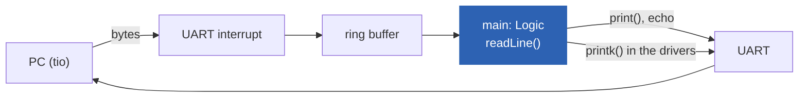
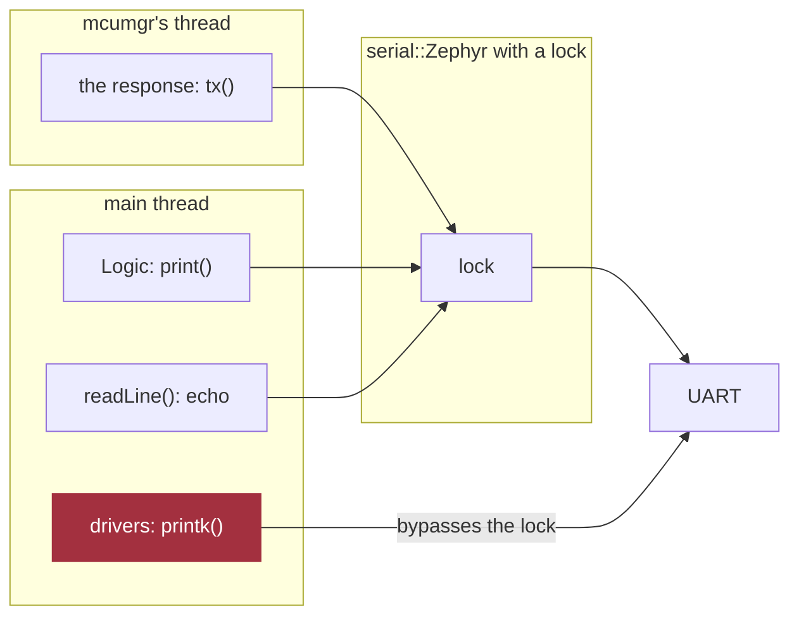
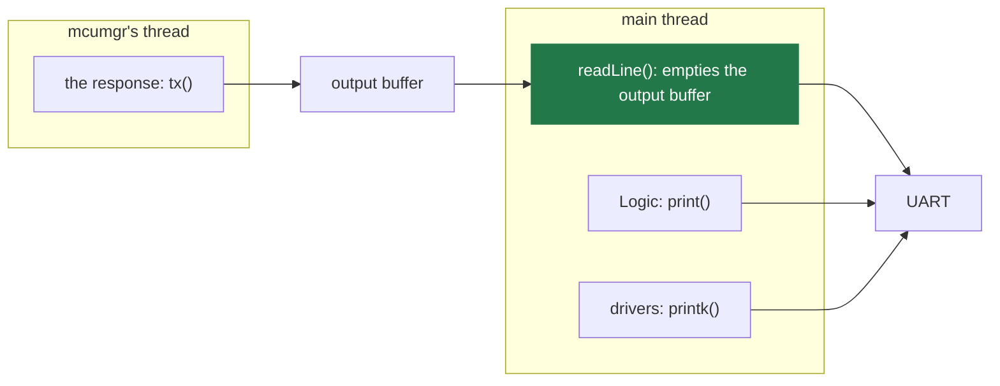
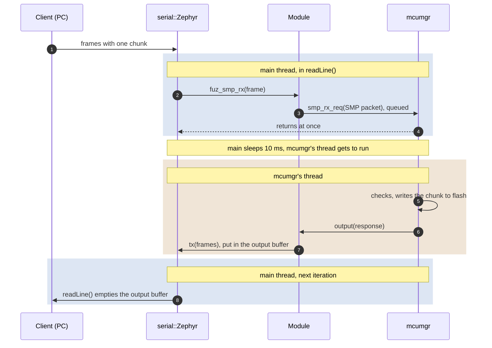
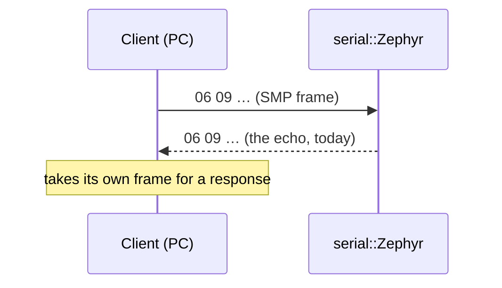

# Threads and the serial port

Appendix to [P02 firmware update flow](flow_en.md). Explains why I propose that only the
main thread writes to the serial port, and what follows from that.

Colours in the diagrams: blue is main (P02's thread, `Logic`'s loop), yellow is mcumgr's thread.

## 1. Today: one thread

P02 has one thread. `Logic`'s loop does one iteration, sleeps 10 ms, does the next iteration. An interrupt
puts received bytes in a ring buffer, which the loop reads. Everything written to the serial port is written
by main, so nothing can get mixed up.



## 2. mcumgr brings a thread of its own

mcumgr handles SMP packets in a thread of its own. It has a lower priority (3) than main (0), so it only runs
when main sleeps. If main wakes up while mcumgr is working, main takes over at once, in the middle of whatever
mcumgr is doing.

```
         0 ms               10                 20                 30
main     ██·················██·················██·················
mcumgr   ··████████████████···██████···································
```

At 10 ms main wakes up and interrupts mcumgr. mcumgr continues when main goes back to sleep.

## 3. The problem: two threads write to the same port

mcumgr sends its response as frames on the serial port. If main wakes up in the middle of a frame and writes a
text line, the text ends up inside the frame:

```
06 09 AAsAAAABAAG/YnJj Zephyr timer timeout detected.\n AGNvZmYZAgC/…CRC \n
└─ frame ────────────┘ └─ text line from main ───────┘ └─ rest of the frame
```

The client receives the frame, but the CRC does not match. The frame is dropped, no response arrives, and the
client gets a timeout.

## 4. Why a lock is not enough

My first proposal was a lock (mutex) in `serial::Zephyr`. But four things write to the port, and one of them
does not go through `serial::Zephyr`: the drivers' `printk()`, for example the timer's line every period and
the GPIO's line every time the LED toggles.



> **The lock only protects what goes through `serial::Zephyr`. `printk()` in main can still end up in the
> middle of mcumgr's frame.**

## 5. The proposal: only main writes

mcumgr's thread does not write by itself. It puts the response in an output buffer in `serial::Zephyr`. Main
empties the buffer in `readLine()`, which is already called every iteration. Everything that reaches the port
is then written by a single thread, one thing at a time, and cannot be mixed.



It is the same pattern that receiving already has, only in the other direction:

| Direction | Fills the buffer | Empties the buffer |
|---|---|---|
| In (exists) | The UART interrupt | main in `readLine()` |
| Out (new) | mcumgr in `tx()` | main in `readLine()` |

## 6. One chunk, step by step

The colour shows which thread runs. The module has no thread of its own: its code runs in the thread that
calls it, first in main, then in mcumgr's thread.



## 7. A fault that exists whatever the solution: the echo

Today `readLine()` sends back every byte it receives, so that whoever types in `tio` sees their characters.
Without a change, every SMP frame would be sent back to the client, which may take it for a response.



> **Fix: `readLine()` decides the line's type from the first byte. `0x06` or `0x04` is SMP and is not
> echoed; everything else is text and is echoed as today.**

## 8. What the proposal costs and requires

| # | Consequence | Why |
|---|---|---|
| F1 | Every response waits at most 10 ms | The response only goes out in main's next iteration. With 512-byte chunks that is about 4 s extra for a 200 KB image |
| F2 | The output buffer must hold a whole response | The largest response is probably `image state-read`, a few hundred bytes as frames. 1 KB is enough, but it is to be measured |
| F3 | If the buffer is full anyway, mcumgr waits | `tx()` waits until main has emptied it. Main never waits for mcumgr, so they cannot deadlock |
| F4 | `Logic` keeps looping after "ready" | The response to `os reset` is in the output buffer. Main must empty it before the restart (250 ms), otherwise the client gets a timeout although the restart happens |
| F5 | Text can come between frames | The timer's and the GPIO's lines are still written during an upload, but only between frames, never inside one. The client must skip them: verify with `smpmgr` |
| F6 | `Logic` does not change | The emptying happens inside `readLine()`, which `Logic` already calls |
