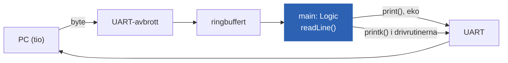
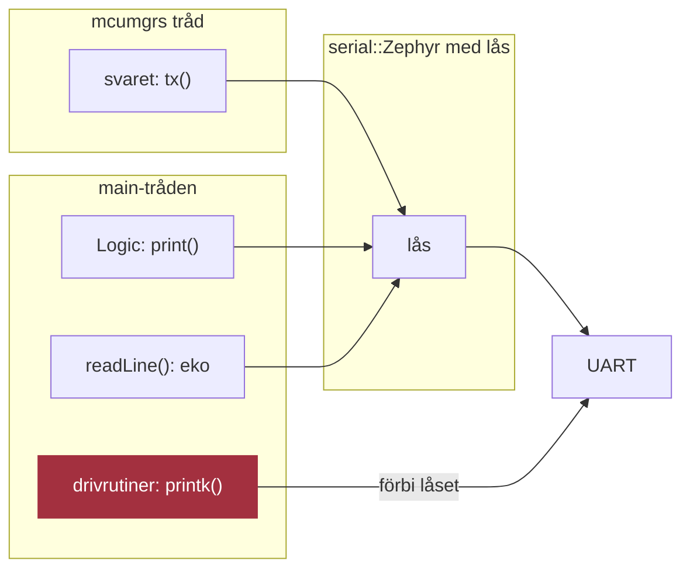
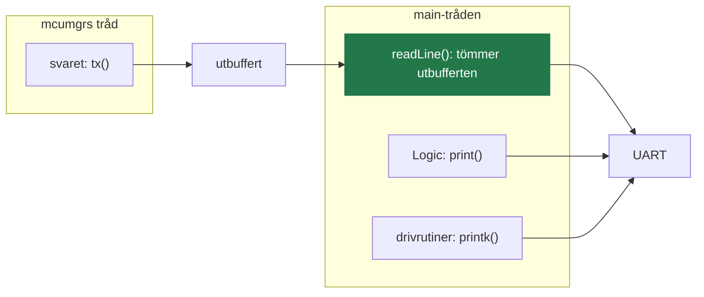
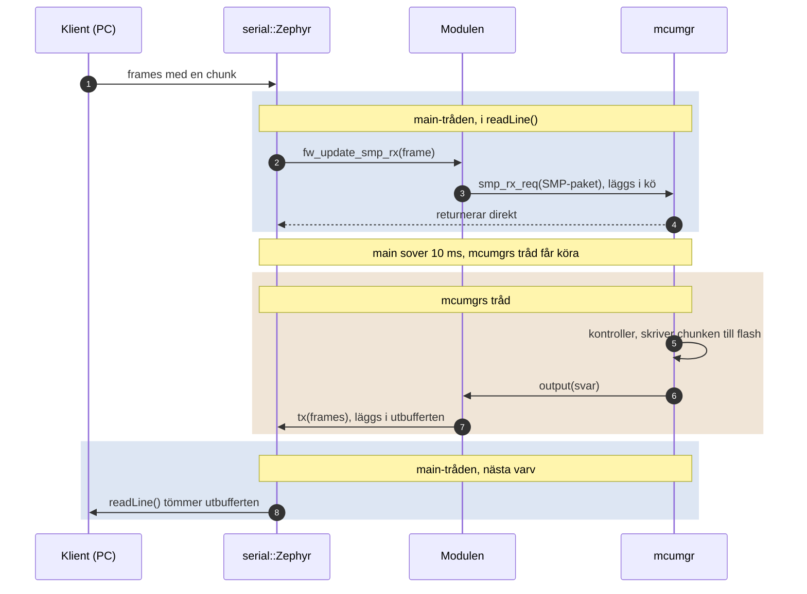
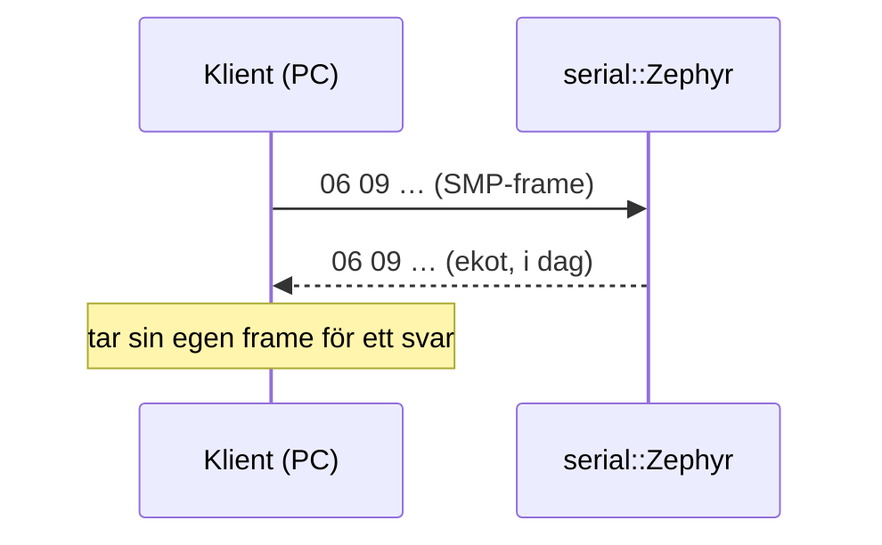

# Trådar och serieporten

Bilaga till [P02 firmware update-flöde](flow_sv.md). Förklarar varför jag föreslår att
bara main-tråden skriver till serieporten, och vad det får för följder.

English: [threads_en.md](threads_en.md)

Färger i diagrammen: blå är main (P02:s tråd, `Logic`s loop), gul är mcumgrs tråd.

## 1. I dag: en tråd

P02 har en tråd. `Logic`s loop gör ett varv, sover 10 ms, gör nästa varv. Ett avbrott lägger mottagna byte i
en ringbuffert, som loopen läser. Allt som skrivs till serieporten skrivs av main, så inget kan blandas ihop.



## 2. mcumgr kommer med en egen tråd

mcumgr behandlar SMP-paket i en egen tråd. Den har lägre prioritet (3) än main (0), så den kör bara när main
sover. Om main vaknar medan mcumgr arbetar, tar main över direkt, mitt i det mcumgr håller på med.

```
         0 ms               10                 20                 30
main     ██·················██·················██·················
mcumgr   ··████████████████···██████···································
```

Vid 10 ms vaknar main och avbryter mcumgr. mcumgr fortsätter när main somnar igen.

## 3. Problemet: två trådar skriver till samma port

mcumgr skickar sitt svar som frames på serieporten. Om main vaknar mitt i en frame och skriver en textrad,
hamnar texten inne i framen:

```
06 09 AAsAAAABAAG/YnJj Zephyr timer timeout detected.\n AGNvZmYZAgC/…CRC \n
└─ frame ────────────┘ └─ textrad från main ─────────┘ └─ resten av framen
```

Klienten tar emot framen, men CRC:n stämmer inte. Framen kastas, inget svar kommer fram, och klienten får en
timeout.

## 4. Varför ett lås inte räcker

Mitt första förslag var ett lås (mutex) i `serial::Zephyr`. Men fyra saker skriver till porten, och en av dem
går inte genom `serial::Zephyr`: drivrutinernas `printk()`, till exempel timerns rad varje period och GPIO:ns
rad varje gång LED:en växlar.



> **Låset skyddar bara det som går genom `serial::Zephyr`. `printk()` i main kan fortfarande hamna mitt i
> mcumgrs frame.**

## 5. Förslaget: bara main skriver

mcumgrs tråd skriver inte själv. Den lägger svaret i en utbuffert i `serial::Zephyr`. Main tömmer bufferten i
`readLine()`, som redan anropas i varje varv. Allt som når porten skrivs då av en enda tråd, en sak i taget,
och kan inte blandas.



Det är samma mönster som mottagningen redan har, fast åt andra hållet:

| Riktning | Lägger i bufferten | Tömmer bufferten |
|---|---|---|
| In (finns) | UART-avbrottet | main i `readLine()` |
| Ut (nytt) | mcumgr i `tx()` | main i `readLine()` |

## 6. En chunk, steg för steg

Färgen visar vilken tråd som kör. Modulen har ingen egen tråd: dess kod körs i den tråd som anropar den,
först i main, sedan i mcumgrs tråd.



## 7. Ett fel som finns oavsett lösning: ekot

`readLine()` skickar i dag tillbaka varje byte den tar emot, så att den som skriver i `tio` ser sina tecken.
Utan ändring skulle varje SMP-frame skickas tillbaka till klienten, som kan ta den för ett svar.



> **Rättning: `readLine()` avgör radens typ på första byten. `0x06` eller `0x04` är SMP och ekas inte, allt
> annat är text och ekas som i dag.**

## 8. Vad förslaget kostar och kräver

| # | Följd | Varför |
|---|---|---|
| F1 | Varje svar väntar högst 10 ms | Svaret går ut först i mains nästa varv. Med chunks på 512 byte är det ungefär 4 s extra för en image på 200 KB |
| F2 | Utbufferten måste rymma ett helt svar | Det största svaret är troligen `image state-read`, några hundra byte som frames. 1 KB räcker, men det ska mätas |
| F3 | Om bufferten ändå är full väntar mcumgr | `tx()` väntar tills main har tömt. Main väntar aldrig på mcumgr, så de kan inte låsa varandra |
| F4 | `Logic` fortsätter loopen efter "redo" | Svaret på `os reset` ligger i utbufferten. Main måste tömma den innan omstarten (250 ms), annars får klienten en timeout fast omstarten sker |
| F5 | Text kan komma mellan frames | Timerns och GPIO:ns rader skrivs fortfarande under en uppladdning, men bara mellan frames, aldrig inuti. Klienten måste hoppa över dem: verifiera med `smpmgr` |
| F6 | `Logic` ändras inte | Tömningen sker inne i `readLine()`, som `Logic` redan anropar |
