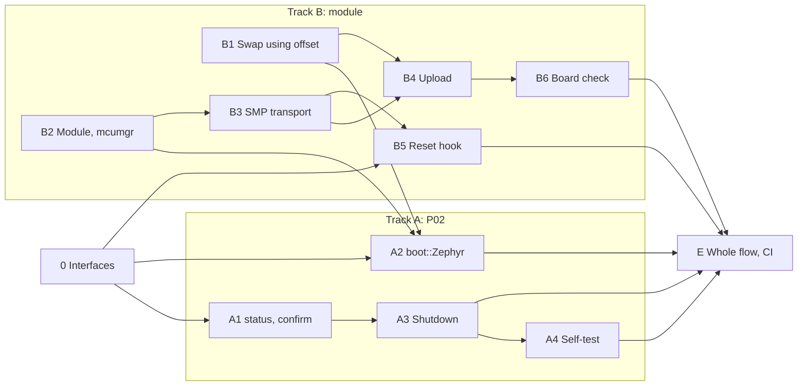

# P02 firmware update: work plan (Proposed)

How the [P02 firmware update flow](flow_en.md) is built. Obsolete once step E is done.

The work is split into small steps, one step per branch and PR. Two tracks can run in parallel after step 0:
**track A** is the P02 side (`Logic` and `boot::Zephyr`), tested mostly on the host with the stub, and
**track B** is the module and the Zephyr side, tested on boards. Whoever did not write a step reviews it and
runs the test in the column *Reviewer tests*. A test on the Nano is done by whoever has the Nano.

## Common start

| Step | What | Depends on | Reviewer tests |
|---|---|---|---|
| 0 Interfaces | New methods in `boot::Interface` and the stub (`isUpdateSupported()`, `isSecondaryPending()`, `isRestartRequested()`, `setReadyForRestart()`, `revert()`), and the module's C API as a header without code: one function per method in `boot::Interface`, plus `fuz_init(tx)` and `fuz_receive_smp_frame(frame)` for `serial::Zephyr`. Whether `confirm()` stays in `boot::Interface` depends on the decision about the text command `confirm`. A small PR both read carefully: everything else builds on it. Also decide here who owns reading the header in slot 1 (A2 and B6 need it, and it must account for swap using offset) | – | The host tests pass |

## Track A: P02

| Step | What | Depends on | Reviewer tests |
|---|---|---|---|
| A1 status and confirm | The text command `confirm` (if kept, see the decision *The text command `confirm`* in [the flow](flow_en.md)), the lines in `status` (`Firmware`, `Second slot`, `(test at next reset)`, `not supported`, `selftest`) and the text command `selftest pass\|fail\|skip`, with the stub | 0 | Host tests; `help` and `status` in `tio` on any board |
| A2 `boot::Zephyr` | The adapter: each method in `boot::Interface` calls a function in the module (`fuz_get_running_version()`, `fuz_is_confirmed()`, `fuz_get_secondary_version()`, `fuz_confirm()` / `fuz_revert()` …) | 0, B1, B2 | The update demo by hand (as in #91): `status` shows version, confirmed and slot 1; test then revert, Nucleo |
| A3 Shutdown | `Logic` asks `isRestartRequested()`, does its shutdown (the line, LED off, blinking off) and signals `setReadyForRestart()`; the loop keeps running after `setReadyForRestart()` until the restart, so that the response to `os reset` gets out | A1 | Host tests with the stub |
| A4 Self-test | The self-test when the image is not confirmed, the line on failure, and `confirm()` or `revert()` by the result; the demo field `selftest` in NVS | A3; on a board also A2 and B2 | Host tests; on a board, `selftest fail` gives a revert and `selftest pass` a confirm |

## Track B: the module

| Step | What | Depends on | Reviewer tests |
|---|---|---|---|
| B1 Swap using offset | `zephyr/app/Kconfig.sysbuild`, the rows in AGENTS.md (no partition changes were needed). Done in #104, which answered the open question *Swap using offset on the Nano* in [the flow](flow_en.md) | – | The update demo (test, then revert), Nucleo and Nano |
| B2 Module and mcumgr | In the module's own repository ([firmware-update-for-zephyr](https://github.com/sigmundrulle/firmware-update-for-zephyr), `modules/fuz` here; its skeleton, `zephyr/module.yml` and Kconfig exist): the module's functions on top of MCUboot's API (version, confirmed, second slot, `fuz_confirm()`, and `fuz_revert()` with `sys_reboot()`); mcumgr enabled in `prj.conf`; CI builds it. Measure the flash on the Nucleo (200 KB slot) | – | CI green; the size in `report/material.md` |
| B3 SMP transport | `serial::Zephyr` passes SMP frames to the module; `smp_transport_init()` and the hooks are registered in the module's `SYS_INIT`, and `fuz_init(tx)` only gives the write function; the ring buffer or sorting in the interrupt; the output buffer for the responses (`fuz_init(tx)`); SMP frames are not echoed | B2 | `smpmgr image state-read` responds and `p02_test.py` passes on the same port, Nucleo and Nano; an upload with blinking on gives no broken frames, and `smpmgr` skips text between frames; the largest response fits in the output buffer (measure) |
| B4 Upload | `smpmgr image upload` to slot 1, progressive erase, mcumgr's checks (size, SHA-256) | B1, B3 | A whole upload with blinking and the watchdog measured, Nano; an image that is too large is rejected |
| B5 Reset hook | The hook and the handshake in the module, with the time limit: the flag (`atomic_t`) and the semaphore (`k_sem`), both proposals; `boot::Zephyr` is connected to it. The hook `MGMT_EVT_OP_CMD_RECV` that rejects `image state write` while the image is not confirmed | 0, B3 | `smpmgr os reset` restarts after the shutdown; an app that does not respond gives `busy`; `image confirm` during the self-test is rejected |
| B6 Board check | The board target TLV at signing, the check in `DFU_PENDING`, erasing the sector with the header | B4 | An image built for another board is erased, and `image test` is rejected |

## Together at the end

| Step | What | Depends on | Reviewer tests |
|---|---|---|---|
| E Whole flow | The whole flow from upload to self-test, confirm or revert, and a hardware test in CI (Nucleo): `selftest fail`, upload, test: revert; then `selftest pass`: confirm | A2–A4, B5, B6 | Both run the demo on their own board before the demo review for the second product's developers |

Meeting points where the tracks must align: step 0 (the interfaces), A3 and B5 (the handshake from each
side), A2 and B2 (the adapter against the module), A4 and B2 (`confirm()` or `revert()`), A2 and B6
(the header in slot 1).
