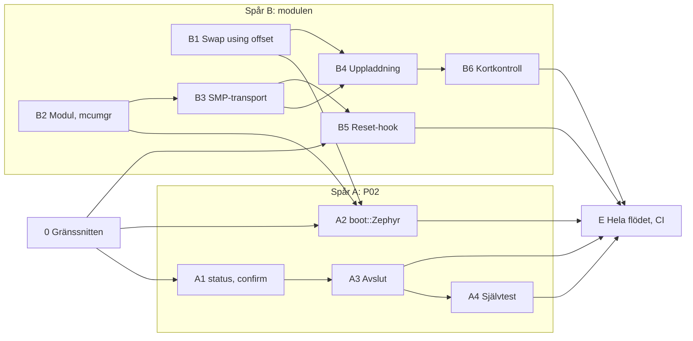

# P02 firmware update: arbetsplan (Förslag)

Hur [P02 firmware update-flöde](flow_sv.md) byggs. Inaktuell när steg E är klart.

English: [work_plan_en.md](work_plan_en.md)

Arbetet delas i små steg, ett steg per gren och PR. Två spår kan gå parallellt efter steg 0: **spår A** är
P02-sidan (`Logic` och `boot::Zephyr`), testad mest på värden med stubben, och **spår B** är modulen och
Zephyr-sidan, testad på kort. Den som inte skrev steget granskar det och kör testet i kolumnen *Granskaren
testar*. Ett test på Nano görs av den som har Nanon.

## Gemensam start

| Steg | Vad | Beror på | Granskaren testar |
|---|---|---|---|
| 0 Gränssnitten | Nya metoder i `boot::Interface` och stubben (`isUpdateSupported()`, `isSecondaryPending()`, `restartRequested()`, `readyForRestart()`, `selfTestDone()`), och modulens C-API som en header utan kod: en funktion per metod i `boot::Interface`, plus `fw_update_init(tx)` och `fw_update_smp_rx(frame)` för `serial::Zephyr`. Om `confirm()` finns kvar i `boot::Interface` beror på beslutet om textkommandot `confirm`. Liten PR som båda läser noga: allt annat bygger på den. Bestäm också här vem som äger läsningen av headern i slot 1 (A2 och B6 behöver den, och den måste ta hänsyn till swap using offset) | – | Värdtesterna går igenom |

## Spår A: P02

| Steg | Vad | Beror på | Granskaren testar |
|---|---|---|---|
| A1 status och confirm | Textkommandot `confirm` (om det behålls, se beslutet *Textkommandot `confirm`* i [flödet](flow_sv.md)), raderna i `status` (`Firmware`, `Second slot`, `(test at next reset)`, `not supported`, `selftest`) och textkommandot `selftest fail\|pass`, med stubben | 0 | Värdtester; `help` och `status` i `tio` på valfritt kort |
| A2 `boot::Zephyr` | Adaptern: varje metod i `boot::Interface` anropar en funktion i modulen (`fw_update_version()`, `fw_update_is_confirmed()`, `fw_update_secondary_version()`, `fw_update_selftest_done()` …) | 0, B1, B2 | Update-demon för hand (som #91): `status` visar version, confirmed och slot 1; test sedan revert, Nucleo |
| A3 Avslut | `Logic` frågar `restartRequested()`, gör sitt avslut (raden, LED av, blink av) och signalerar `readyForRestart()`; loopen fortsätter efter `readyForRestart()` tills omstarten, så att svaret på `os reset` hinner ut | A1 | Värdtester med stubben |
| A4 Självtest | Självtestet när imagen inte är confirmed, raden vid fel och rapporten `selfTestDone()`; demofältet `selftest` i NVS | A3; på kort även A2 och B2 | Värdtester; på kort ger `selftest fail` revert och `selftest pass` confirm |

## Spår B: modulen

| Steg | Vad | Beror på | Granskaren testar |
|---|---|---|---|
| B1 Swap using offset | `zephyr/app/Kconfig.sysbuild`, raderna i AGENTS.md (inga partitionsändringar behövdes). Klar i #104, som besvarade den öppna frågan *Swap using offset på Nano* i [flödet](flow_sv.md) | – | Update-demon (test, sedan revert), Nucleo och Nano |
| B2 Modul och mcumgr | `modules/fw_update/` med `zephyr/module.yml` och Kconfig; modulens funktioner ovanpå MCUboots API (version, confirmed, andra sloten, `fw_update_selftest_done()` med confirm eller `sys_reboot()`); mcumgr påslaget i `prj.conf`; CI bygger det. Mät flashen på Nucleo (200 KB slot) | – | CI grönt; storleken i `report/material.md` |
| B3 SMP-transport | `serial::Zephyr` lämnar SMP-frames till modulen; `smp_transport_init()` och hookarna registreras i modulens `SYS_INIT`, och `fw_update_init(tx)` ger bara skrivfunktionen; ringbufferten eller sorteringen i avbrottet; utbufferten för svaren (`fw_update_init(tx)`); SMP-frames ekas inte | B2 | `smpmgr image state-read` svarar och `p02_test.py` går igenom på samma port, Nucleo och Nano; en uppladdning med blink på ger inga trasiga frames, och `smpmgr` hoppar över text mellan frames; det största svaret ryms i utbufferten (mät) |
| B4 Uppladdning | `smpmgr image upload` till slot 1, progressiv radering, mcumgrs kontroller (storlek, SHA-256) | B1, B3 | En hel uppladdning med blink och watchdog mätta, Nano; en för stor image nekas |
| B5 Reset-hook | Hooken och handskakningen i modulen, med tidsgränsen: flaggan (`atomic_t`) och semaforen (`k_sem`), båda förslag; `boot::Zephyr` kopplas till den. Hooken `MGMT_EVT_OP_CMD_RECV` som nekar `image state write` medan imagen inte är confirmed | 0, B3 | `smpmgr os reset` startar om efter avslutet; en app som inte svarar ger `busy`; `image confirm` under självtestet nekas |
| B6 Kortkontroll | Board target-TLV:n vid signering, kontrollen i `DFU_PENDING`, raderingen av sektorn med headern | B4 | En image byggd för ett annat kort raderas, och `image test` nekas |

## Tillsammans till sist

| Steg | Vad | Beror på | Granskaren testar |
|---|---|---|---|
| E Hela flödet | Hela flödet från uppladdning till självtest, confirm eller revert, och ett hårdvarutest i CI (Nucleo): `selftest fail`, uppladdning, test: revert; sedan `selftest pass`: confirm | A2–A4, B5, B6 | Båda kör demon på var sitt kort före granskningen av demon för den andra produktens utvecklare |

Mötespunkter där spåren måste stämma av: steg 0 (gränssnitten), A3 och B5 (handskakningen från var sitt håll),
A2 och B2 (adaptern mot modulen), A4 och B2 (`selfTestDone()` → confirm eller reset), A2 och B6 (headern i
slot 1).
